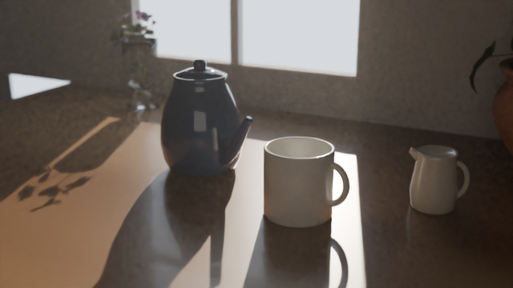

# Morning coffee: a ceramic pot, mug and jug, simulated in 3D with OpenFOAM and rendered in Blender Cycles

Preview (half resolution, fast render): [media/preview.mp4](media/preview.mp4)

Continuous take, 720p (8 samples, OIDN, then an ffmpeg `nlmeans` pass): [media/coffee_film_720p.mp4](media/coffee_film_720p.mp4)

An 11.1 s film in one continuous take, 24 fps (`scene2.py film`). It runs on the simulations' own clock, so film time is steam time:
1. **establish** (2.5 s): the morning table with an empty mug. The pot lifts and tilts into the pour.
2. **pour** (4.6 s): coffee from the tilted ceramic pot fills the mug. Once the stream stops, the pot is set back and the
   jug moves in.
3. **milk** (4 s): cold milk is poured from the jug for 3 s. Meanwhile the front half of the mug fades away into a
   cut-away, which shows the milk mixing while the jug is still pouring.

There are no cuts. The camera glides between the framings along a monotone cubic path. The simulated pour surface
dissolves into the resting surface of the milk part. The old four-shot version is still available as
`scene2.py anim SHOT ...`.

## Geometry → CFD → render
- `models.py` builds the ceramic pot, mug and milk jug in Blender. The handles' ends sink into the walls, so they
  are attached.
  - The mug is exported as `geometry/mug.stl`, a closed, watertight solid.
  - That same file is the wall in all three OpenFOAM simulations.
- **Coffee pour, 3D** (`mk_pour3d.py`, `interFoam`):
  - The mug starts empty and fills to 6.65 cm at 83 mL/s.
  - The stream leaves the spout at 0.70 m/s, along the spout direction at 89° tilt.
  - OpenFOAM writes the coffee surface (α = 0.5 iso-surface) as an STL each frame, and Blender imports it directly
    (`seq2/pour/`).
- **Milk, 3D** (`mk_milk3d.py`, `twoLiquidMixingFoam`): cold milk (5 °C, 1033 kg/m³) is poured into the 80 °C
  coffee for 3 s.
  - `prep2.py` colours the milk with Kubelka–Munk mixing, both from above (depth-weighted over the top ~6 mm) and
    on the cut plane y = 0. The result is `seq2/milk.npz`.
- **Steam, 3D, coupled to the pour** (`mk_steam3d.py`, `run_steam3d.py`):
  - Humid air is simulated over the whole film with `rhoReactingBuoyantFoam` (reactions off).
  - Each 1/6 s, the cells currently filled with coffee (the rising level plus the falling stream, from the pour
    result) are held at 70 °C, saturated and at rest. So there is no steam over the empty mug, and the plume grows
    as the mug fills.
  - Room air is at 22 °C and 40 % RH, with a gentle, slowly varying draught of 2–3 cm/s.
  - `steam_atlas.py` computes condensed water at local equilibrium, including latent heat, on a 3 mm voxel grid.
    It stores the grid as slice atlases (`seq2/steam_atlas.npz`), which Blender's volume shader reads.
  - Extinction is physical, for 2 µm droplets.

## Decoration (free assets, `assets/`)
- *Glass Vase Flowers*, from the Khronos glTF Sample Assets, CC0.
- *Diffuse Transmission Plant* by Eric Chadwick / Darmstadt Graphics Group, from the Khronos glTF Sample Assets,
  **CC-BY 4.0**. Credit is required if you publish the film.

## Honest limits
- The meshes are coarse (2–5 mm cells), so the stream and splash are slightly blocky.
- The steam is one-way coupled. The coffee drives the air, but the air does not cool the coffee.
- The pot's and jug's motion is posed, not simulated; the coffee inside the pot is not modelled.
- The milk stream above the coffee is drawn along its ballistic path; the simulation starts where it enters.

## Render (Windows, NVIDIA GPU)
1. Install Python 3.13 from python.org, then run
   `py -3.13 -m pip install bpy==5.2.2 numpy scipy scikit-image imageio-ffmpeg`.
2. Run `render_film2.bat`.
   - It renders 266 frames at 1920×1080 and 256 samples, then joins them into `coffee_film_v2.mp4`.
   - For a fast draft, run `scene2.py film 1280 720 8 frames720` with `VOL_STEP=4` and `BOUNCES=4` set.
   - Expect a few hours on an RTX 3070. For a quicker test, set `SPP=64`.
   - If it is interrupted, run it again: frames that already exist are skipped.

## Re-running the simulations (Linux, OpenFOAM v2412)
Set `OF_ENV` to your OpenFOAM `etc/bashrc` if it isn't in the default location. `thermo/` holds the humid-air
thermophysical files for the steam case.
1. `mk_pour3d.py`, `mk_milk3d.py` and `mk_steam3d.py` write the cases.
2. `run_steam3d.py` drives the coupled steam run. It needs the pour result and its cell centres.
3. `prep2.py` and `steam_atlas.py` export the results to `seq2/`.

## Folder layout
| Path | Contents |
|---|---|
| `scene2.py`, `coffee_scene.py`, `models.py` | Blender scene, room and lighting, and the pot, mug and jug models |
| `make_film2.py`, `render_film2.bat` | render all shots and join them into the film |
| `mk_*.py`, `run_steam3d.py`, `prep2.py`, `steam_atlas.py`, `thermo/` | OpenFOAM case setup and export to `seq2/` |
| `seq2/` | cached simulation results used by the renderer (pour surfaces, milk colours, steam volume) |
| `geometry/mug.stl` | the mug used as the CFD wall |
| `assets/` | decoration models (see credits above) |

## Licence
Code: GPL-3.0 (see `LICENSE`). The decoration models in `assets/` keep their own licences (CC0 and CC-BY 4.0, see above).
